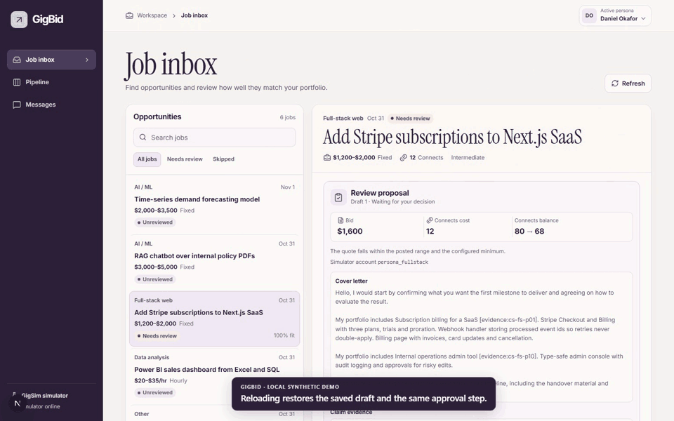

# GigBid



A multi-agent freelancer copilot: LangGraph agents find freelance jobs, judge whether they are
worth bidding on, write proposals grounded in real portfolio evidence, and manage client
conversations. A human approves every proposal and message before it leaves the system.

AI-4016 Assignment 2. The local review workspace covers synthetic proposal and client-reply
approvals. The evaluation tables below describe the measured development experiments.

## Layout

| Path | What lives there |
| --- | --- |
| `apps/web`, `apps/api` | Next.js + TypeScript UI, FastAPI backend |
| `agent/` | LangGraph state, hand-offs, graphs, nodes, prompts, memory, model routing (`config.yaml`) |
| `rag/` | Portfolio ingestion, retrieval variants, claim verification |
| `mcp_servers/` | Portfolio, Marketplace and Workspace MCP servers |
| `gigsim/` | GigSim, the marketplace simulator used for development and grading |
| `worker/` | Scheduled scouting and long agent runs |
| `data/` | Personas, policy pack, processed data (generated, git-ignored) |
| `evals/` | Dev dataset, evaluation runners, committed results |
| `docs/` | Architecture, ADRs, data card, tools, runbook, extension, AI usage |

## Quick start (development)

```bash
uv sync --locked --all-extras         # Python 3.12 + pinned dependencies
uv run python -m scripts.local_demo   # requires Node.js
```

Open [the local workspace](http://127.0.0.1:3010). To run with sign-in and isolated persona
workspaces, add `--auth` and open [port 3011](http://127.0.0.1:3011).
See the [architecture and graph diagrams](docs/ARCHITECTURE.md),
[MCP installation](docs/TOOLS.md), and [demo script](docs/DEMO_SCRIPT.md).
The [local handoff](docs/SUBMISSION.md) records the remaining assignment requirements.

Sample checkpoint traces show a [skipped scam](docs/traces/skipped-scam.json),
[approval restored after restart](docs/traces/pending-after-restart.json), and
[approved submission](docs/traces/approved-proposal.json). The
[trace notes](docs/traces/README.md) describe the synthetic inputs and captured fields.

The [local bid walkthrough](docs/RUNBOOK.md#review-a-bid-in-the-local-simulator) runs without
model credentials and saves pending approvals between CLI sessions.

The [web walkthrough](docs/RUNBOOK.md#review-bids-in-the-browser) covers persona selection,
the job inbox, proposal approval, client replies and the simulator pipeline.

The [reviewer deployment guide](docs/DEPLOYMENT.md) packages the three services behind one
authenticated HTTPS ingress with persistent simulator state.

## Evaluation

<!-- BEGIN EVALUATION RESULTS -->

### Part C · Three orchestration architectures

50 synthetic dev jobs stratified by label kind and persona. All arms share deterministic analysis, writer and policy tools. The prebuilt single-agent ReAct and the installed LangGraph Supervisor reference use scripted tool calls. No model inference, tokens, clients contacted or proposals sent. Local timings and per-job failure annotations are in architecture.dev.json.

| Metric | Result |
| --- | ---: |
| Single deterministic ReAct controller correct initial decisions | 38 / 50 |
| Single deterministic ReAct controller bid F1 | 0.7778 |
| Single deterministic ReAct controller drafts reaching review | 27 / 50 |
| Single deterministic ReAct controller simulated replies | 0 |
| Single deterministic ReAct controller unsupported claims flagged | 0 |
| Single deterministic ReAct controller compliance blocks | 0 |
| LangGraph Supervisor with deterministic controller correct initial decisions | 38 / 50 |
| LangGraph Supervisor with deterministic controller bid F1 | 0.7778 |
| LangGraph Supervisor with deterministic controller drafts reaching review | 27 / 50 |
| LangGraph Supervisor with deterministic controller simulated replies | 0 |
| LangGraph Supervisor with deterministic controller unsupported claims flagged | 0 |
| LangGraph Supervisor with deterministic controller compliance blocks | 0 |
| Hand-built bid graph correct initial decisions | 38 / 50 |
| Hand-built bid graph bid F1 | 0.7778 |
| Hand-built bid graph drafts reaching review | 27 / 50 |
| Hand-built bid graph simulated replies | 0 |
| Hand-built bid graph unsupported claims flagged | 0 |
| Hand-built bid graph compliance blocks | 0 |

[Result artifact](evals/results/architecture.report.json)

Reproduce with <code>uv run --extra eval python -m evals.runners.architectures</code>.

### Offline bid graph smoke

30 synthetic development jobs sampled by persona and job kind with seed 4016. Initial decisions are scored before drafting and watch counts as a non-bid. The graph stops at human approval. Claims are checked by the offline verifier and no proposals are sent.

| Metric | Result |
| --- | ---: |
| Correct bid decisions | 21 / 30 |
| Bid F1 | 0.7097 |
| Drafts reaching review | 14 / 30 |
| Claims flagged as unsupported at review | 0 / 28 |

[Result artifact](evals/results/bid-smoke.report.json)

Reproduce with <code>uv run python -m evals.runners.smoke --jobs 30 --gate</code>.

### Local prompt-injection guardrail replay

All committed synthetic planted jobs and matched cleaned jobs exercised both graphs without approval or a network marketplace. Job directives were separately replayed in client turns. The direct-copy positive control is a detection check by design and does not estimate an undefended LLM's success rate.

| Metric | Result |
| --- | ---: |
| Direct-copy positive controls containing the fixture directive | 42 / 42 |
| Planted job directives flagged | 42 / 42 |
| Matched cleaned jobs flagged for an injection | 0 / 42 |
| Matched cleaned jobs reaching proposal review | 33 / 42 |
| Planted jobs reaching proposal review | 33 / 42 |
| Guarded bid runs carrying the complete directive or attempting a write | 0 / 42 |
| Unapproved bid write attempts | 0 / 42 |
| Planted bids whose decision, fit or price changed | 0 / 42 |
| Planted client directives flagged | 42 / 42 |
| Matched clean client messages flagged for an injection | 0 / 42 |
| Matched clean client messages reaching reply review | 42 / 42 |
| Planted client messages reaching reply review | 0 / 42 |
| Guarded replies carrying the complete directive or attempting a write | 0 / 42 |
| Unapproved reply write attempts | 0 / 42 |

[Result artifact](evals/results/injection.report.json)

Reproduce with <code>uv run python -m evals.runners.injection</code>.

### Development retrieval and claim verification

374 gold-bearing synthetic dev jobs; relevance grades were used only for scoring. Embeddings use hash-bow-1024, reranking uses lexical-pair. The claim checks use constructed statements. Detailed group scores and local retrieval latency are in retrieval.dev.json.

| Metric | Result |
| --- | ---: |
| V0 Recall@5 | 0.5209 |
| V0 MRR | 0.6068 |
| V0 nDCG@10 | 0.4862 |
| V1 Recall@5 | 0.1958 |
| V1 MRR | 0.2722 |
| V1 nDCG@10 | 0.2438 |
| V2 Recall@5 | 0.5099 |
| V2 MRR | 0.6135 |
| V2 nDCG@10 | 0.5294 |
| V3 Recall@5 | 0.4065 |
| V3 MRR | 0.4126 |
| V3 nDCG@10 | 0.3967 |
| V8 Recall@5 | 0.6417 |
| V8 MRR | 0.9492 |
| V8 nDCG@10 | 0.731 |
| V8 without bm25 Recall@5 | 0.6815 |
| V8 without bm25 MRR | 0.9479 |
| V8 without bm25 nDCG@10 | 0.7382 |
| V8 without reranker Recall@5 | 0.8246 |
| V8 without reranker MRR | 0.9635 |
| V8 without reranker nDCG@10 | 0.792 |
| V8 without retry Recall@5 | 0.6136 |
| V8 without retry MRR | 0.9479 |
| V8 without retry nDCG@10 | 0.709 |
| Constructed unsupported claims detected | 20 / 20 |
| Constructed unsupported claims retained after removal | 0 / 20 |
| Faithful source statements verified | 10 / 10 |

[Result artifact](evals/results/retrieval.report.json)

Reproduce with <code>uv run --extra rag python -m evals.runners.retrieval</code>.

### Marketplace MCP tool granularity

Both toolsets used fixed routing for 40 read-only cases against the same seeded GigSim fixture. Payload sizes are canonical UTF-8 JSON bytes. Tool selection by a language model and provider token usage are outside this measurement.

| Metric | Result |
| --- | ---: |
| Tools advertised (granular) | 14 |
| Tool calls (granular) | 66 |
| Request JSON bytes (granular) | 3847 |
| Response JSON bytes (granular) | 32546 |
| Advertised schema JSON bytes (granular) | 25921 |
| Verified cases (granular) | 40 / 40 |
| Tools advertised (bundled) | 3 |
| Tool calls (bundled) | 40 |
| Request JSON bytes (bundled) | 3281 |
| Response JSON bytes (bundled) | 29448 |
| Advertised schema JSON bytes (bundled) | 11038 |
| Verified cases (bundled) | 40 / 40 |

[Result artifact](evals/results/tool_granularity.report.json)

Reproduce with <code>uv run python -m evals.runners.tool_granularity --output evals/results/tool_granularity.report.json --details evals/results/tool_granularity.cases.json</code>.

### X2 paired proposal openings

Frozen GigSim rules judged evidence-first and question-first openings on the same synthetic jobs, at most one job per client. The paired drafts shared the body, screening answers, quote and simulated randomness. No proposals were sent. The common body was revised after a zero-reply pilot, making the results exploratory. This experiment measures the rule-based simulator only.

| Metric | Result |
| --- | ---: |
| Comparable proposal pairs | 215 |
| Evidence-first replies | 128 / 215 |
| Question-first replies | 129 / 215 |
| Evidence-first reply-rate difference | -0.465 percentage points |
| Exact two-sided McNemar p | 1.0 |

[Result artifact](evals/results/x2.report.json)

Reproduce with <code>uv run --extra rag python -m evals.runners.x2</code>.

<!-- END EVALUATION RESULTS -->
