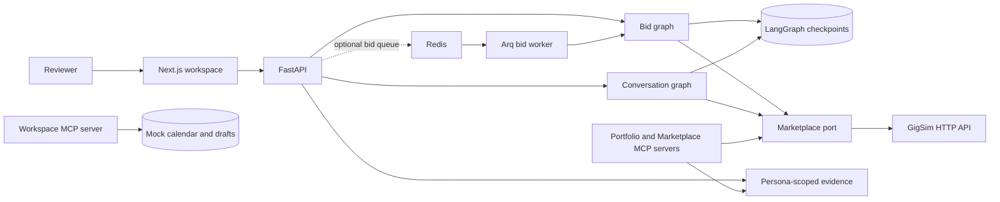
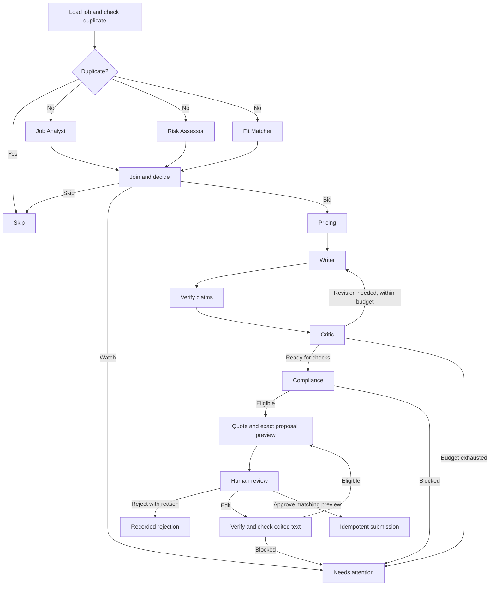
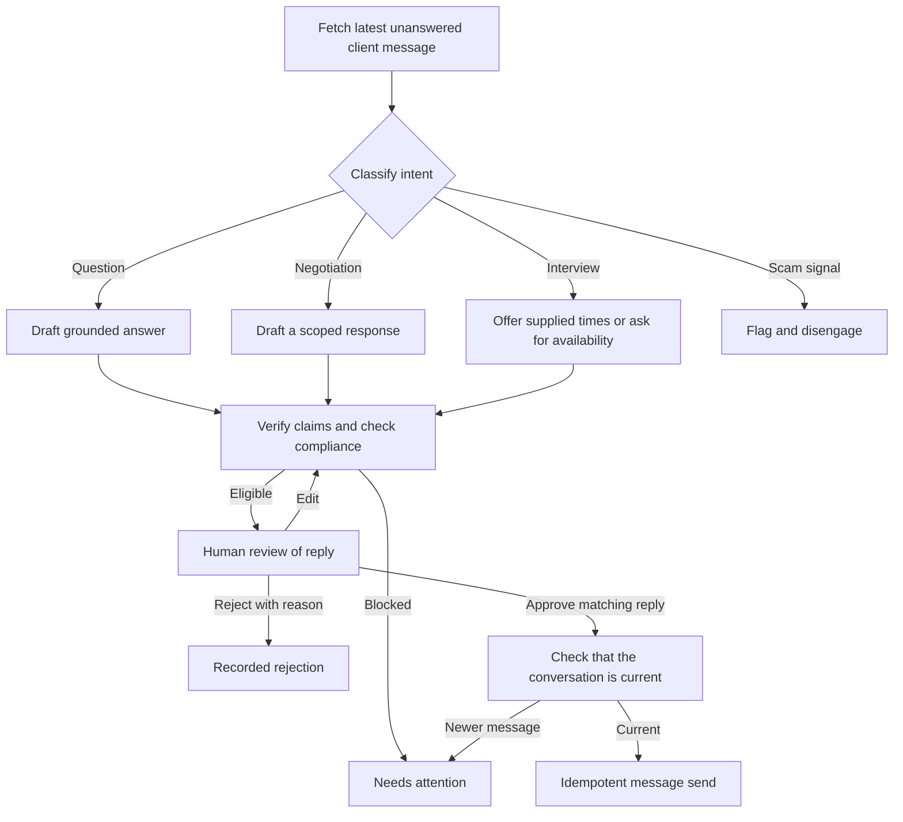

# Architecture

GigBid's local workspace reviews synthetic freelance listings, proposals and conversations.
The browser sends typed requests to FastAPI through same-origin Next.js rewrites. FastAPI uses
the selected persona's server-held credential to read GigSim through the marketplace port. The
same checkpoint retains the exact review payload when the page or API restarts.

The direct local mode uses SQLite checkpoints. `GIGBID_CHECKPOINT_DSN` enables the PostgreSQL
checkpointer and `GIGBID_QUEUE_URL` enables Redis-backed bid preparation. The API and worker use
the same checkpoint backend and workspace store in Compose. The browser receives LangGraph
task metadata using Server-Sent Events. Redis relays worker events, and checkpoint history
supports refresh and a downloadable local trace. Optional scouting stages at most three
unseen jobs per persona per cycle, respecting each saved search's selected interval.

In authenticated local mode a workspace owns one seeded persona out of three. The session
cookie authorizes workspace operations, and the persona's configured marketplace credential
and checkpoint scope isolate approvals, messages and workspace settings. The local launcher
creates a separate simulator database and rotates its synthetic interface credentials.
Workspace preferences include weekly Connects, a preferred rate, uploaded text evidence and
saved searches. New bids use those settings while every outbound action requires approval.

## Bid graph

The Job Analyst extracts the job specification. The Risk Assessor checks marketplace text for
scams and prompt injection. The Fit Matcher ranks scoped portfolio evidence independently of the
Analyst. LangGraph fans out to these three nodes and joins them before applying decision rules.
Pricing applies persona and Connects limits. The Writer drafts from selected evidence, the
verifier checks claims, and the Critic can request up to two revisions within the step budget.
The compliance guard applies the policy pack before the preview is created.

Review covers the exact proposal, price and Connects quote. The approval digest binds the
preview to its version. Editing sends the revised text back through claim and compliance checks
and creates a new preview. Rejection records a reason. The separate submit node checks the saved
approval and replays an existing receipt with the same idempotency key after a lost response.

## Conversation graph

The liaison treats each client message as untrusted input. It uses supplied evidence for past
work claims and supplied, time-zone-aware availability for interview offers. Negotiation uses an
explicit price policy when provided. Without one, it discusses scope before confirming a price.
The outbound message passes the message policy pack, including restricted contact, payments and
unsupported experience claims. Its approval digest binds the account, thread, incoming message
and exact draft version. A stable key identifies one send per incoming turn. Workspace calendar
holds and email drafts are separate mock tools.

## Evidence, tools and trust boundaries

| Boundary | Implementation |
| --- | --- |
| Browser to API | OpenAPI generates the TypeScript client. The browser selects a synthetic persona. FastAPI verifies the corresponding GigSim account before marketplace writes and serializes each local review thread. |
| Market data to agents | Job and message bodies contain untrusted text. Deterministic classification, scoped portfolio evidence and policy checks constrain outbound text. The only graph nodes that write to GigSim are the separate approved submit and send steps. |
| API to simulator | The `MarketplacePort` selects the GigSim HTTP adapter. GigSim checks account ownership and persists idempotency receipts. Its frozen v1.0 quote and submit are separate requests, so keep simulator time and policy stable between approval and submission when demonstrating quote recovery. |
| MCP clients to tools | The three local servers expose typed contracts through the Python MCP SDK. Streamable HTTP uses separate server tokens. Preview-first writes and scoped credentials reduce accidental mutations. See [MCP tools](TOOLS.md) for the independent tool paths and audit coverage. |
| Corpus to claims | The retrieval package provides persona-scoped indexing, five variants, and claim verification experiments. The offline review graph uses deterministic portfolio matching and conservative evidence checks. The [evaluation results](EVALUATION_RESULTS.md) identify which implementation each experiment measured. |

The browser graph currently calls the typed port directly. The MCP servers expose independent
routes over the same simulator and portfolio data. The mock Workspace stores drafts and holds in
SQLite. The local stack uses synthetic data throughout.

## Durability, traces and memory

- **Checkpoint state** contains typed intermediate decisions, the exact review payload, the
  human response and the simulator receipt. Thread IDs include the simulator realm, account and
  job or conversation. A fresh simulator database requires a fresh review checkpoint.
- **Audit and run history** serve different views. The browser timeline reads LangGraph
  checkpoints. MCP tool audits record attempt and receipt metadata with fingerprints instead of
  bodies or bearer tokens. GigSim maintains its own marketplace events and idempotency records.
- **Promoted memory** uses explicit tenant-scoped rules. A style rule needs evidence from three
  consistent approved edits across two jobs within the ten most recent distinct approved edits.
  An outcome feature needs eight observations and a Wilson lower bound above its category
  baseline. Promotions retain supporting event IDs and rule versions. Deletion leaves a tombstone
  so the same evidence cannot promote the item again.

The integration tests exercise review across a checkpoint reopen, stale approvals, unsafe edits,
and lost responses after a committed marketplace write. The browser tests cover the local journey
from proposal review to pipeline and from a synthetic client interview request to an approved reply.
See the [timed demo script](DEMO_SCRIPT.md) for the repeatable synthetic interview setup.
